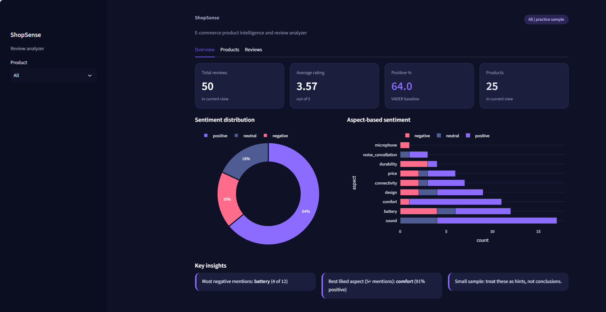

# ShopSense — E-commerce Product Intelligence & Review Analyzer

**CodeAlpha Data Analytics Internship Project**

ShopSense is a data analytics project developed as part of the CodeAlpha internship. It combines web scraping, data cleaning, exploratory data analysis (EDA), data visualization, and sentiment analysis into one workflow.

The project explores product information and customer-review patterns using Python and presents the analytical results through an interactive Streamlit dashboard.

## Project Objectives

The main objective is to demonstrate practical data analytics skills through an end-to-end project:

- Collect structured information using web scraping.
- Clean and validate raw datasets.
- Perform exploratory data analysis to identify patterns and relationships.
- Create meaningful visualizations.
- Analyze review sentiment using NLP techniques.
- Explore aspect-based sentiment using keyword matching.
- Present findings through an interactive dashboard.

## Key Features

### 1. Web Scraping
- Used Python Requests and BeautifulSoup.
- Scraped product information from Books to Scrape, a website designed for scraping practice.
- Extracted book titles and prices from 11 books.
- Exported scraped information into CSV format.

### 2. Data Cleaning & Preparation
- Identified and removed one junk row (51 to 50 records).
- Preserved three reviews with missing ratings.
- Checked for duplicate records.
- Prepared the dataset for analysis.

### 3. Exploratory Data Analysis (EDA)
- Analyzed rating and sentiment distributions.
- Examined the relationship between ratings and sentiment.
- Explored price versus average product rating.
- Calculated descriptive statistics and correlation.

### 4. Data Visualization
- Created exploratory charts using Matplotlib.
- Developed interactive visualizations using Plotly.
- Presented analytical findings through a Streamlit dashboard.

### 5. Sentiment Analysis
- Applied VADER as a baseline sentiment-analysis method.
- Classified reviews into positive, neutral, and negative categories.
- Performed a manual evaluation using 18 labelled reviews.

### 6. Aspect-Based Sentiment Analysis
- Used keyword matching to identify product aspects.
- Explored aspects such as battery life, comfort, connectivity, sound quality, and price.
- Split reviews around the word "but" to identify contrasting opinions.

## Dataset Information

This project uses two separate datasets for demonstration:

| Dataset | Description |
|---|---|
| Practice review dataset | 50 generated practice reviews covering approximately 25 earbud products |
| Scraped dataset | 11 books collected from Books to Scrape, including titles and prices |

**Important:** The earbud reviews are generated practice data, not real customer reviews. The scraped book dataset demonstrates web scraping and does not contain customer reviews.

## Results & Findings

The following results are based only on the 50-review practice dataset.

| Metric | Result |
|---|---:|
| Total reviews | 50 |
| Positive reviews | 32 |
| Neutral reviews | 9 |
| Negative reviews | 9 |
| Average rating | 3.57 |
| Price vs. average rating correlation | 0.36 |

### Average Rating by Sentiment

| Sentiment | Average Rating | Rated Reviews |
|---|---:|---:|
| Negative | 1.71 | 7 |
| Neutral | 3.00 | 8 |
| Positive | 4.13 | 32 |

### VADER Evaluation

- Evaluation sample: 18 manually labelled reviews.
- Accuracy: 83% (15 out of 18 predictions).
- Neutral-class F1-score: 0.57.

These results demonstrate the workflow on a small practice dataset. They should not be interpreted as reliable estimates of real-world product or market behaviour.

## Dashboard Preview

The Streamlit dashboard provides an interactive view of:
- Overall review statistics.
- Sentiment distribution.
- Aspect-based sentiment.
- Product-level analysis.
- Review insights.

## Tech Stack

| Technology | Purpose |
|---|---|
| Python | Core programming |
| Requests | Fetching web pages |
| BeautifulSoup | HTML parsing and scraping |
| Pandas & NumPy | Data cleaning and analysis |
| Matplotlib | Exploratory visualizations |
| Plotly | Interactive charts |
| NLTK (VADER) | Sentiment analysis |
| Scikit-learn | Evaluation metrics |
| Streamlit | Interactive dashboard |
| Jupyter Notebook | Analysis and experimentation |

## Project Structure

```text
ShopSense/
│
├── notebooks/
│   ├── data_loading.ipynb
│   ├── data_cleaning.ipynb
│   ├── web_scraping.ipynb
│   ├── eda.ipynb
│   ├── visualization.ipynb
│   ├── sentiment_analysis.ipynb
│   └── aspect_analysis.ipynb
│
├── data/
│   ├── raw/
│   └── processed/
│
├── app/
│   └── app.py
│
├── .streamlit/
│   └── config.toml
│
├── requirements.txt
└── README.md
```

## Installation & Setup

**1. Clone the repository**

```bash
git clone YOUR_GITHUB_REPOSITORY_URL
cd ShopSense
```

**2. Create a virtual environment**

```bash
python -m venv venv
```

**3. Activate the environment**

Windows:

```bash
venv\Scripts\activate
```

macOS/Linux:

```bash
source venv/bin/activate
```

**4. Install dependencies**

```bash
pip install -r requirements.txt
```

**5. Run the Streamlit dashboard**

```bash
python -m streamlit run app/app.py
```

Run the command from the project root directory.

## Limitations & Future Improvements

### Current Limitations
- The review dataset contains only 50 generated practice reviews.
- The VADER evaluation uses only 18 manually labelled reviews.
- Reviews were labelled by one person.
- Custom sentiment lexicon adjustments have not been independently evaluated.
- Aspect-based sentiment accuracy has not yet been measured.
- Handwritten aspect keywords may miss reviews that use different expressions.

### Future Improvements
- Collect larger datasets from permitted sources.
- Evaluate sentiment models on a larger manually labelled dataset.
- Improve aspect detection using NLP techniques.
- Compare VADER with machine-learning-based sentiment models.
- Add more product comparison and filtering options.
- Improve dashboard interactivity and reporting.

## Learning Outcomes

Through this project, I practised:

- Web scraping and structured data extraction.
- Data cleaning and preprocessing.
- Exploratory data analysis.
- Data visualization and interpretation.
- Natural Language Processing fundamentals.
- Sentiment classification and evaluation.
- Building interactive dashboards using Streamlit.

## Acknowledgement

This project was developed as part of the **CodeAlpha Data Analytics Internship**.

The scraping demonstration uses [Books to Scrape](https://books.toscrape.com/), a website intended for web scraping practice.

## Dashboard Preview
<p align="center">
  
</p>

**ShopSense — Turning Product Reviews into Data-Driven Insights.**
